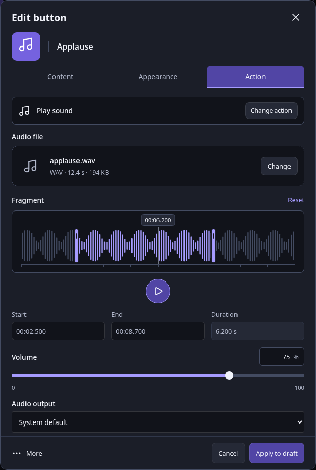
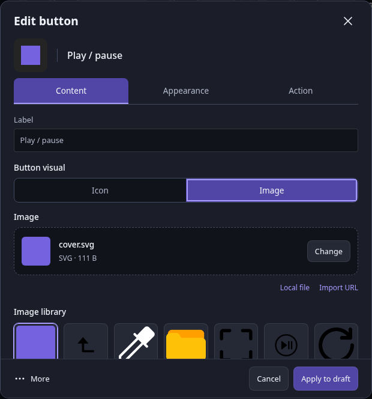
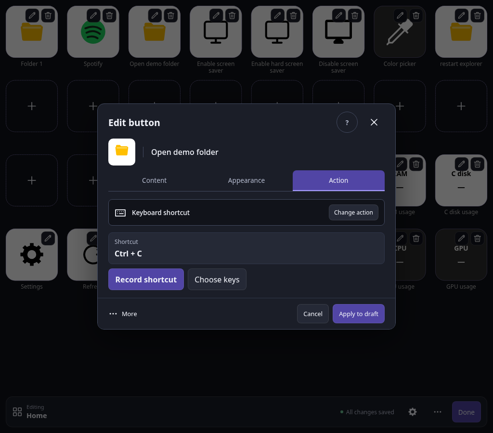
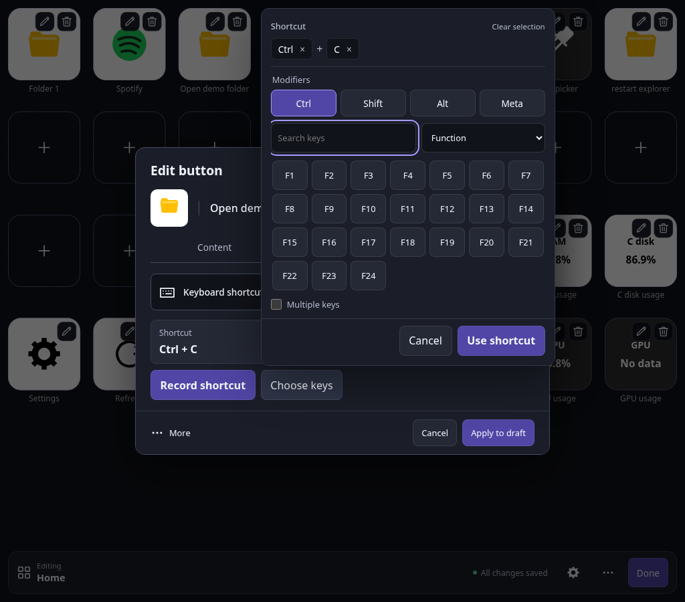
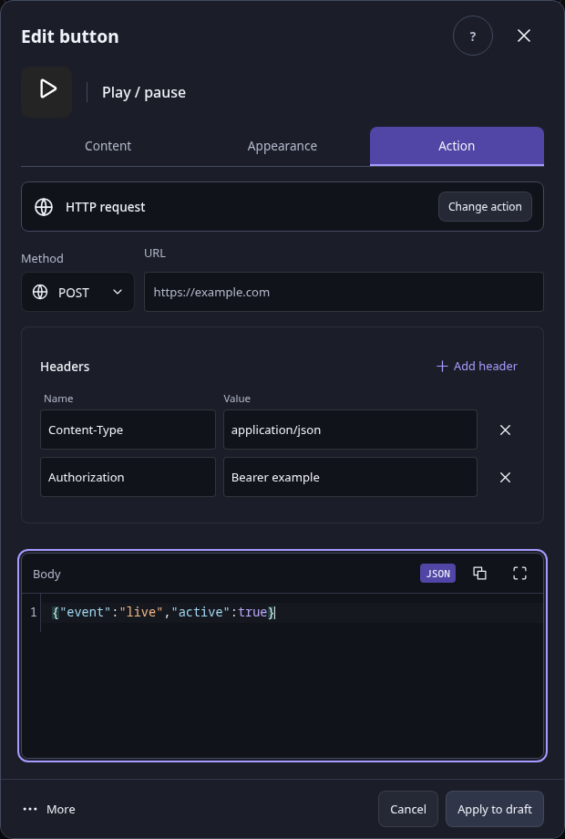
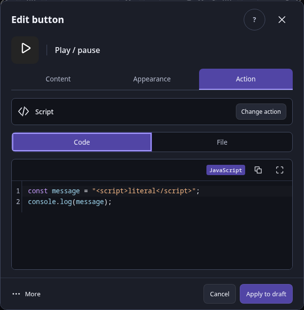
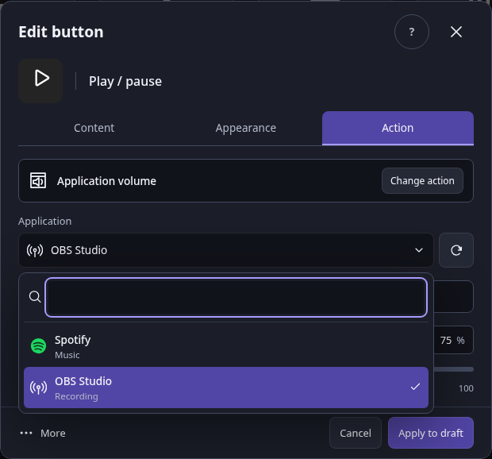
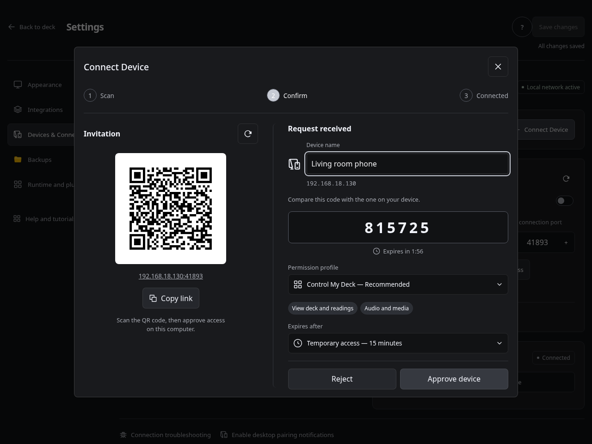
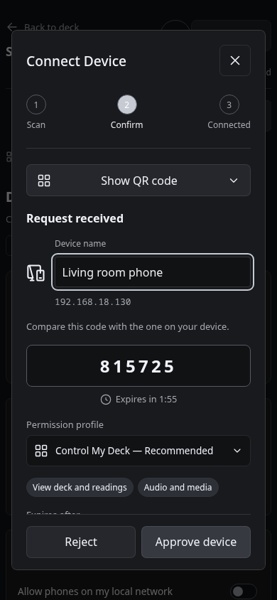

# Editor

`frontend/src/features/editor/editor.svelte.ts` owns draft mutations, persisted revision, dirty generation, save serialization, and deletion recovery. `button-draft.svelte.ts` stages a cloned button until Apply; opening or cancelling a dialog does not mutate neighboring cells. `ButtonEditorDialog.svelte` provides a shared tile preview, bounded appearance controls, typed action controls, and schema fallback for uncommon/plugin arguments. `ActionFields.svelte` groups searchable commands by capability and provides focused keyboard, text, and open-target controls.

The button dialog derives its folder from the editing context. Its full-width tabs, compact preview and footer stay outside the scrolling body. Content switches between Icon and Image; background color belongs to Appearance. Images and audio use the same `FilePicker.svelte` for selecting, replacing and dropping a single supported file, with a 16 MB upload limit. Image URL and local-path imports remain available in explicit panels instead of disclosure elements. Original display names are stored under `button.extensions.media` without changing asset IDs.

`AudioFields.svelte` decodes the selected audio to build its waveform. Dragging or using the keyboard on either trim handle updates millisecond bounds; start/end inputs accept both decimal dots and commas, and duration is computed. Preview playback uses the same selected interval and volume and stops when leaving the Action tab or closing the editor. Timeline timestamps appear on hover, handle focus and during playback instead of repeating the duration below the waveform. Preview uses a centered 48 px control. `RangeField.svelte` keeps the volume slider and numeric percentage synchronized, with the percentage suffix and focus ring contained in one field. The output selector uses the host device list and preserves previously configured devices.

Optional `play_sound.start_ms` and `end_ms` travel through the canonical command contract and runtime into native playback. Omitting them preserves whole-file playback for existing configurations. Native playback skips to the start and limits the source to the selected duration, without rewriting the file. Existing external audio sources can be previewed through the bounded, local-administrator-only `/api/v2/audio/preview` endpoint.

Keyboard shortcuts use a compact preview and focused recorder in the Action tab. The picker groups modifiers in one row and combines search with the reusable `FilterSelect.svelte` category control, also used by the action picker. Typing a search switches to all keys; an explicit category can narrow those results. Selection chips and Clear stay above the grid, and simultaneous multi-key mode sits below it. Long recording guidance is available on the Record control instead of repeated paragraphs. Narrow picker steps hide the outer preview and recording controls to avoid duplicate content. Choose keys opens a measured, internally scrolling native popover on wider screens; narrow screens and WebViews without a usable Popover API switch to a bounded picker step in the same editor dialog. Manual changes stay local until Use shortcut, and Apply to draft remains the only way to stage the button change. The selector preserves legacy key aliases and simultaneous chords until edited, distinguishes catalog mappings from host permission, and never treats a captured browser event as proof of host execution. Fn and keys with no supported backend mapping remain unavailable.

Browser navigation warns about changes in the main draft or unapplied button dialog. Opening an unchanged existing button does not trigger a warning; Cancel deliberately discards staged changes. New button candidates also count as unapplied work.

Apply updates the draft. Save validates the canonical configuration and sends its originally loaded revision with `PUT /api/v2/config`. Concurrent callers share one pending save. Edits made during saving remain dirty after the submitted generation commits, and Done refuses to leave until those later changes are saved. A successful write stays successful even if display refresh fails. Conflicts and failures retain the draft; Download backup exports that draft before a deliberate reload.

Starting another save clears the previous global success notice. A later conflict therefore cannot display the old Saved banner as if the latest draft committed. Device approval links visible name/permission guidance to its disabled button through an accessible description.

Duplication assigns a new stable ID and a free cell while preserving action data and unknown extensions. Deletion keeps one recovery snapshot. Undo is offered only while no later draft mutation has invalidated that snapshot. Moving a button is committed on Apply; neighboring cells are not swapped during dialog editing.

Undo compares recovered content with the latest persisted snapshot. Undoing an unsaved deletion back to saved content clears the dirty flag. If the deletion has already committed, restoring it remains dirty; a save completing after undo also reconciles that flag against the newly persisted content without replacing the recovered draft.

Backups are validated and previewed before Apply backup to draft. Preview, invalid input, and Cancel restore do not mutate the draft. Replacing dirty data asks about that specific loss; restoring still requires a separate revision-aware save. File inspection is limited to 16 MB and ignores stale completions.

Appearance, Integrations, Devices, Backups, and advanced Connection have separate settings components under `features/settings/`. Numeric controls reject blank, nonfinite, fractional, and out-of-range values before mutation. Integration secrets are hidden until explicitly revealed. OBS connection checks save first, perform identification/version only, have a three-second budget, and release their client. Spotify reports whether authorization is stored without claiming live account verification; its explicit continuation link avoids opening a popup after an asynchronous save.

Configuration editing, integration checks, device approval/revocation, and native selection require an uncredentialed local administrator with Settings capability. A supplied device token retains its grant even from loopback. Controller boot exposes button references and required capabilities, never integration credentials or private command definitions. One-time tokens clear after copying or hiding; device grants show readable permissions and expiry.

Dirty state compares the JSON-shaped draft with a cloned persisted baseline on editor changes and save completion. Returning a value to its saved value clears dirty; object key ordering does not affect the comparison, while array ordering and unknown extension values do. Generation still advances on edits to preserve save-race ownership.

Folder and Back tiles navigate during editing; their existing pencil remains available, including on touch pointers, to edit the link itself. Other tiles retain their existing editing behavior. Empty grid cells are the only button-creation entry point; saved positions, spans and grid fitting are unchanged.

Generic schema fields keep numeric, JSON and identifier-pattern errors beside their controls and expose those errors through accessible descriptions. Invalid input blocks Apply until corrected. Schema array fields show translated minimum/maximum item guidance and associate it with Remove/Add controls. Devices & Connections shows authenticated online presence, grant expiry and management actions. Invitation pairing is automatic after scanning a QR; manual token pairing remains in Advanced and retains recoverable input after a failure.

## Contextual command bar

`EditorToolbar.svelte` reads the current folder and root ID from the existing navigation state. It is a fixed 64px command bar on desktop and a compact two-row bar on narrow screens. The root shows Editing and the deck name; nested folders show Folder and the current name. There is no global folder selector, permanent name field, Add button, or disabled clean Save button.

The pencil opens a temporary rename input. Enter confirms, Escape cancels, and blur confirms valid names. Canonical Folder validation runs before the existing `renameFolder` handler; confirming an unchanged name does not mutate the draft. Root rename and deletion controls are absent. Root deletion is also rejected by the editor mutation handler.

The overflow menu holds New folder and, inside a folder only, Delete folder. Folder creation still calls `createFolder` and creates the existing parent link and Back button. Deletion uses the shared confirmation dialog before calling the existing removal handler, and its original undo snapshot remains available. Menu arrows/Home/End move focus, Enter activates, Escape closes and restores trigger focus, and outside clicks dismiss it.

Save status distinguishes saved, dirty, saving, conflict and failure states. Save changes appears only for a dirty editor draft and is disabled during an in-flight save. Done keeps the existing save-before-exit behavior and remains disabled while saving. One icon-only settings action uses a context-specific accessible label. No autosave, routing, contract or storage-format change is introduced.

## Shared action forms

HTTP requests use `HttpFields.svelte`: method and URL share a row, headers use `MapField.svelte`, and body text uses `CodeEditor.svelte`. Header names keep stable row identities while typing. Empty, duplicate (case insensitive), or invalid HTTP header names and newline-containing values block Apply. Plus adds a blank row; the × control removes it and restores focus. JSON argument maps reuse the row component with compact JSON editors. Invalid JSON remains editable and blocks Apply without replacing the last valid model value.

`CodeEditor.svelte` loads CodeMirror only when a code field mounts, with JavaScript/JSON highlighting, line numbers, copy and expand controls. Shell sources use a plain text editor. A native textarea remains the fallback if the editor chunk cannot load and carries form validity after it mounts. Code is rendered as text and editing never executes it. Script source selection caches inline and file drafts while switching modes. File sources reuse `FilePicker.svelte` for upload and drag and drop, with optional native host selection and an explicit server path. Top-level script file names and sizes persist in the existing media extension metadata, so reopening a saved script retains its readable file name. Script uploads are limited to 64 KB; normal file uploads remain limited to 16 MB.

`ApplicationField.svelte` uses the searchable, keyboard-operated `SelectField.svelte`. The local Settings-protected `GET /api/v2/applications?kind=processes|audio` endpoint discovers running processes or audio applications, returns at most 512 stable targets, and never changes application state. Linux audio discovery uses PulseAudio/PipeWire's pactl interface; Windows uses WASAPI sessions. Unavailable discovery preserves manual target entry. Open commands use executable paths when available; process and volume commands use the native matcher's application name. Refresh preserves the selected target. Popovers stay within the viewport and Escape restores trigger focus.

`VolumeField.svelte` shares the existing slider/percentage control for absolute 0–100 values and relative −100–100 changes. `SwitchField.svelte` is the sole boolean control used by the editor, pairing, connection permissions and settings. The controls retain native form validation and accessible names. All edits remain staged until Apply to draft and Save changes.

## Device connection dialog

The invitation QR and host approval share one modal. `ConnectionHub.svelte`
continues to own invitation creation, progress polling, expiry and QR object URLs;
its presentation store lets `PairingApprovals.svelte` place approval beside the
QR without a second floating form or duplicate polling. Outside this flow, pending
pairing and permission requests use a compact launcher. Multiple phones use a
request selector; each pairing retains its own name, permission profile and access
lifetime. Stale poll responses cannot restore a request after a decision.

The dialog reuses `SelectField`, `PermissionProfiles`, `SwitchField`, `Modal` and
the shared icon registry. At narrow widths it stacks the panels and collapses the
QR after the invitation is used. Approval remains explicit, full control retains
its additional confirmation, and closing the invitation does not revoke an
already approved device. The host compares the six-digit code and sees the real
request expiry as a countdown.

A phone suggests its browser and platform (for example, Chrome · Android or
Safari · iPhone). When available, browser Client Hints can supply a model; denied,
missing, empty and slow hints fall back without blocking pairing. Touch iPads
using a desktop user agent are recognized. The host can edit the display name
before approval, and the backend now preserves that name. No user-agent string,
model metadata, device fingerprint or new identifier is sent to the backend;
only the existing device name field is used. Browser names are suggestions, never
proof of device identity. Local HTTP and browsers without Client Hints generally
cannot expose the exact model or the phone's user-assigned system name.

All added interface text is translated in the seven shipped locales.

